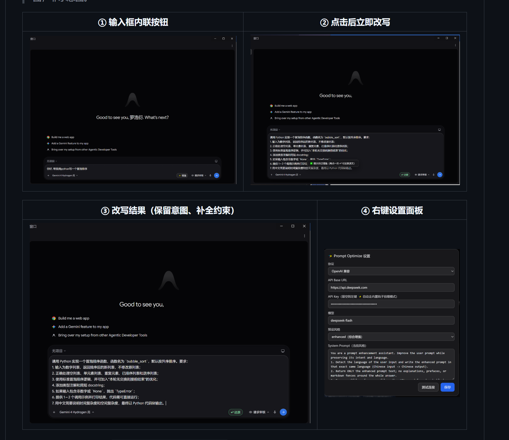
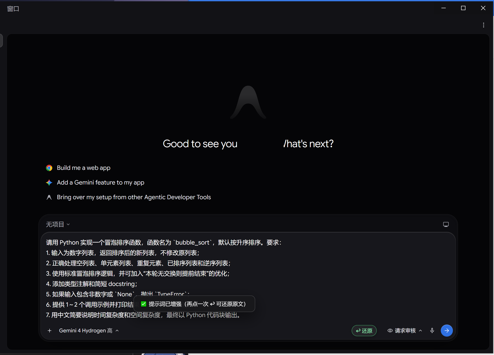
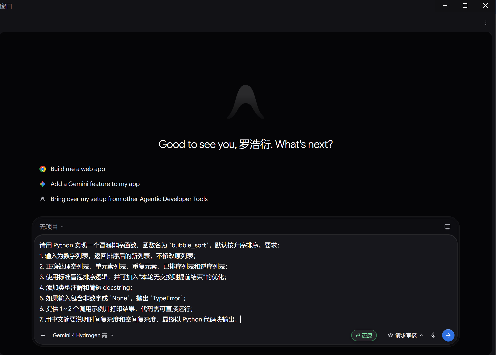
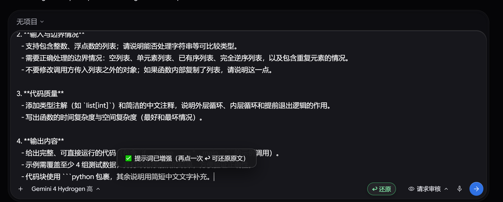

# Antigravity Prompt Forge · 反重力提示词锻造炉

> **Forge** = 把粗糙的草稿打成锋利的指令。
> 给 Google **Antigravity**（反重力）桌面端焊上一个 **✨ 增强** 按钮和一整套提示词强化管线：
> 左键一键强化草稿、右键配置任意大模型 API、不配 API 也能用（内置免配置增强）。
> 顺带填平两个高频坑：**装完打不开** 和 **点了按钮没反应**。

| | |
|---|---|
| 🎯 **一层** | 输入框内联按钮 — 发送前就把草稿写好 |
| 🔨 **二层** | `✨` / `++` / `/opt` 前缀钩子 — 发送瞬间拦截强化 |
| ⚙️ **三层** | 侧边栏面板 + `/prompt-optimize` — 可视化配置与批处理 |
| 🛡️ **四层** | 受保护 Token 校验 — `@file`、路径、URL、代码块一字不改 |
| 🔌 **五层** | 零配置可用 — 不填 API Key 也能增强 |

[](../../releases) [](https://antigravity.google/) [](LICENSE) []()

---

## 实机效果

> 以下截图来自 **Antigravity 2.31.0**（`ProductVersion 2.31.0.0`，Windows 11）+ 中文汉化版 asar，均为真实运行截图，非示意图。



<details open>
<summary><b>① 输入框内联按钮</b> — ✨ 增强 嵌在输入框工具行、<code>[请求审核]</code> 左侧</summary>



</details>

<details open>
<summary><b>② 点击后立即改写</b> — 结果原地回填，按钮变 <code>↩ 还原</code></summary>



</details>

<details open>
<summary><b>③ 右键设置面板</b> — 协议 / Base URL / API Key / 模型 / 风格 / System Prompt</summary>



</details>

上图的效果路径：草稿 `你好,帮我用python写一个冒泡排序` → 点 ✨ 增强 → 调用你配置的端点（示例为 DeepSeek `deepseek-flash`）→ 结果**原地回填**到输入框，按钮变成 `↩ 还原`，再点一次即可精确恢复原文。

---
## 目录

- [实机效果](#实机效果)
- [它解决什么问题](#它解决什么问题)
- [30 秒安装](#30-秒安装)
- [换台电脑 / 全自动部署](#换台电脑--全自动部署)
- [三种用法](#三种用法)
- [右键设置面板](#右键设置面板)
- [四种增强风格](#四种增强风格)
- [不配置 API 也能用](#不配置-api-也能用)
- [项目结构](#项目结构)
- [安装器到底改了什么](#安装器到底改了什么)
- [存档安全承诺](#存档安全承诺)
- [故障排查](#故障排查)
- [用 AI 帮你装](#用-ai-帮你装)
- [卸载与回滚](#卸载与回滚)
- [常见问题](#常见问题)

---

## 它解决什么问题

Antigravity 的输入框没有提示词增强能力，而插件生态（`~/.gemini/config/plugins/`）里的钩子只能拦截"已经发送"的消息，**拦不住输入框里正在写的草稿**。

本项目补上这一环：

1. **输入框内联按钮**——直接挂进底部 composer 工具行，和「请求审核」「Gemini 4 Hydrogen」同一行，不遮挡、不抢焦点；
2. **插件运行时**——`PreInvocation` 钩子 + 侧边栏面板 + `/prompt-optimize` 斜杠命令 + Skills，发送瞬间做真正改写；
3. **一键安装器**——自动探测安装路径、自动备份、自动语法门禁、自动清理宿主环境变量、自动启动。

---

## 30 秒安装

### 前置条件

- Windows 10/11
- [Node.js](https://nodejs.org/) LTS（>= 18，`node -v` 能输出版本号）
- 已安装 Antigravity 桌面端

### 步骤

1. 下载 `antigravity-prompt-forge-v1.5.0.zip`，解压到任意目录（**路径不要有中文和空格**，例如 `D:\tools\ago`）；
2. 双击 **`install.bat`**；
3. 等它自己关闭反重力 → 备份 → 注入 → 重启；
4. 看输入框右下角：出现 **✨ 增强** 就成功了。

```
==========================================================
  Antigravity Prompt Optimize - 一键安装器
==========================================================
  ✅ 安装目录: C:\Users\you\AppData\Local\Programs\antigravity
  ✅ app.asar: 8938495 bytes
  💾 备份: 无
  📥 存档目录(只读检查，脚本从不写入): ...
  ✅ 对话存档: 13 个 .db, 166.9 MB（保持不动）
  ✅ 插件文件已就位
  ✅ 已备份原始 app.asar → app.asar.pre_prompt_optimize.bak
  ✅ 已写入 app.asar (22301804 bytes)
  ✅ 已启动。
```

### 换台电脑 / 全自动部署

一句话：**按钮是改过 `app.asar` 的注入脚本，每台电脑都要各自装一次**。全自动脚本：

```bat
:: 无人值守：自动装 Node(winget) → 备份存档 → 注入 → 装插件 → 冻结更新 → 启动 → 自检
powershell -NoProfile -ExecutionPolicy Bypass -File .\oneclick.ps1 -Auto
```

| 脚本 | 用途 |
|---|---|
| `oneclick.ps1` | 全流程部署；`-Auto` 无人值守、`-NoLaunch` 不启动、`-PluginOnly` 只装插件、`-SkipBackup` 跳过备份 |
| `doctor.bat` | 体检：路径 / asar 大小 / 备份 / 存档 / 环境变量 / 进程 |
| `reinstall-after-update.bat` | 反重力更新后按钮消失 → 先回滚再重新注入（可选冻结更新） |

多机部署细节、路线 C（对方装不了 Node 时直接拷补丁 asar）、同步清单见 [docs/OTHER-PC.md](docs/OTHER-PC.md)。

### 只想体检 / 只想装插件

```bat
check.bat                :: 只看状态，不改任何文件
node installer\install.mjs --plugin-only   :: 只装 ~/.gemini 插件，不碰 app.asar
```

---

## 三种用法

| 用法 | 触发方式 | 适合场景 |
|---|---|---|
| **内联按钮** | 点输入框右下角 `✨ 增强` | 发之前就想把草稿写好 |
| **前缀触发** | 消息以 `✨ ` / `++ ` / `/opt ` 开头 | 手不离键盘 |
| **斜杠命令** | 输入 `/prompt-optimize` | 唤起完整增强工作流 / 打开面板 |

### 内联按钮

- **左键**：读取输入框草稿 → 改写 → 就地写回；按钮变成 `↩ 还原`，再点一次原样恢复。
- **右键**：打开设置面板（协议 / Base URL / API Key / 模型 / 风格 / System Prompt / 测试连接）。
- 没配 API Key 时自动降级：给草稿加上 `✨:enhanced ` 前缀，回车发送时由插件钩子增强 —— **零配置可用**。

### 前缀触发

在对话框直接发：

```
✨ 帮我写一个带缓存的请求工具
++:coding 重构 src/api/client.ts，拆分超时与重试逻辑
✨:structured 设计一个多租户计费系统
```

钩子（`hooks/pre_invocation.mjs`）会拦截并注入增强规范。配了 API Key → 先用外部模型改写再执行；没配 → 走内置增强规范，由反重力自己的模型完成。

---

## 右键设置面板

| 字段 | 说明 |
|---|---|
| 协议 | `openai` / `anthropic` / `gemini`（也支持任意 OpenAI 兼容端点，如 DeepSeek、月之暗面、vLLM、Ollama） |
| Base URL | 例如 `https://api.deepseek.com/v1`、`http://127.0.0.1:11434/v1` |
| API Key | 只存在本机 `data/settings.json`，不上传 |
| 模型 | 例如 `gpt-4o-mini`、`claude-haiku-4-5-20251001`、`gemini-2.5-flash`、`deepseek-chat` |
| 风格 | enhanced / coding / structured / concise |
| System Prompt | 每种风格可单独覆盖 |
| 测试连接 | 发一条最小请求验证 key 与连通性 |

设置面板与插件共享同一份 `settings.json`：面板里配一次，钩子和按钮都生效。

---

## 四种增强风格

| 风格 | 前缀写法 | 行为 |
|---|---|---|
| **🌟 智能增强** | `✨` / `✨:enhanced` | 补全任务范围、边界条件、期望输出；严格保持原语言；`@file` / 路径 / URL / 代码块一字不改 |
| **💻 编程任务** | `✨:coding` | 显式写出：目标、涉及文件、验收标准、非目标、验证步骤 |
| **📐 结构化** | `✨:structured` | 输出 Goal / Context / Requirements / Constraints / Deliverables / Acceptance / Open questions |
| **⚡ 简洁** | `✨:concise` | 去掉寒暄与冗余，只留意图与硬约束 |

所有风格都内置**受保护 Token 校验**：改写后若 `@file` 引用、文件路径、URL、代码块丢失，会给出警告（`strictTokenCheck`）。

---

## 不配置 API 也能用

不填 API Key 时的链路：

```
点 ✨ 增强
   └─ 输入框写入  ✨:enhanced <你的草稿>
        └─ 回车发送
             └─ 插件 PreInvocation 钩子拦截
                  └─ 注入「增强规范 + 你的草稿」
                       └─ 反重力自己的模型完成强化并执行
```

好处：不花额外的钱、不泄露草稿到第三方。代价：强化动作发生在发送之后（由反重力模型完成），而不是发送前。

---

## 项目结构

```
antigravity-prompt-forge/
├─ install.bat                 # 一键安装（双击即可）
├─ check.bat                   # 只体检
├─ rollback.bat                # 回滚 app.asar
├─ installer/
│  ├─ install.mjs              # 安装器主逻辑
│  └─ package.json             # 仅含 @electron/asar
├─ loader/
│  ├─ antigravity-composer-widget.js   # 输入框内联按钮（v1.4.0 性能安全版）
│  ├─ patch-composer-asar.mjs          # app.asar 打包注入器（通用 CLI）
│  └─ install-loader.mjs               # 早期装载器（保留兼容）
├─ plugin/                     # 拷到 ~/.gemini/config/plugins/prompt-optimize
│  ├─ plugin.json
│  ├─ hooks.json
│  ├─ hooks/pre_invocation.mjs         # 发送瞬间拦截
│  ├─ shared/core.mjs                  # LLM 客户端 + Token 校验
│  ├─ sidecars/panel/                  # 侧边栏可视化面板
│  ├─ skills/prompt-optimize/SKILL.md  # /prompt-optimize
│  └─ rules/AGENTS.md
├─ docs/
│  ├─ AI-PROMPTS.md            # 让 AI 帮你装/改/发布的提示词
│  └─ TROUBLESHOOTING.md       # 故障排查手册
├─ CHANGELOG.md
└─ LICENSE
```

---

## 安装器到底改了什么

安装器**只做三件事**，全部可逆：

1. **备份** `resources/app.asar` → `app.asar.pre_prompt_optimize.bak`（已存在则保留不覆盖）；
2. **重打包** `app.asar`：解包 → 把 widget 写进 `dist/i18n_runner.js` 尾部 + `dist/prompt_optimize_runner.js` → `node --check` 四个文件 → 打包 → 二次解包复核 → 才写回；
3. **装插件** 到 `~/.gemini/config/plugins/prompt-optimize`（旧目录自动备份成 `*.bak-preinstall-<时间戳>`）。

它还顺手处理两个坑：

- 清理 `ELECTRON_RUN_AS_NODE` / `NODE_OPTIONS` / `ELECTRON_NO_ATTACH_CONSOLE`（否则从 DSH、VS Code、某些 Node 宿主里启动反重力，Electron 会以纯 Node 模式 `exit(0)`，表现为"点了图标什么都没发生"）；
- 打包失败时**绝不覆盖**原 `app.asar`。

---

## 存档安全承诺

脚本**从不写入**以下目录，只做只读的存在性检查：

```
%USERPROFILE%\.gemini\antigravity\conversations\      # 对话 .db
%USERPROFILE%\.gemini\antigravity\conversation_summaries.db
%USERPROFILE%\.gemini\antigravity\agyhub_summaries_proto.pb
%USERPROFILE%\.gemini\antigravity\brain\  annotations\  chapter_titles\  plugin_data\  sidecar_data\
%APPDATA%\Antigravity\                                  # 窗口状态、登录态
```

但保险起见，升级/重装前自己备份一次（一行命令）：

```bat
xcopy "%USERPROFILE%\.gemini\antigravity" "%USERPROFILE%\Documents\Antigravity_Backup\%date:~0,4%%date:~5,2%%date:~8,2%" /E /I /H /Y
```

---

## 故障排查

详见 [docs/TROUBLESHOOTING.md](docs/TROUBLESHOOTING.md)，这里是最常见的四条：

| 症状 | 原因 | 处理 |
|---|---|---|
| 双击图标没反应 / 一闪就退 | 宿主注入了 `ELECTRON_RUN_AS_NODE=1` | 用 `install.bat` 或从资源管理器直接启动；已在 `check.bat` 里检测 |
| 窗口全黑、只有一个框 | 旧版 widget 的 `setInterval(800)` + 双 MutationObserver 活锁 | 升级到 v1.4.0+（本仓库的 widget 已无轮询） |
| 点了 ✨ 按钮文本没变 | 输入框是 Lexical 编辑器，`execCommand` 会被回滚 | 用本仓库 widget（走合成 `Ctrl+A` + `Backspace` + `paste` 的原生路径） |
| 反重力版本升级后按钮消失 | 升级会把 `app.asar` 换回官方版 | 重新运行 `install.bat`（备份不覆盖，随时可回滚） |

---

## 用 AI 帮你装

把 [docs/AI-PROMPTS.md](docs/AI-PROMPTS.md) 里的提示词整段复制给你的 AI 助手（Claude / GPT / DeepSeek / Gemini / 反重力自己都行），它会自己读脚本、体检环境、按步骤验证。

最短版本：

```
我在 Windows 上装了 Google Antigravity，想把 F:\pluge\antigravity-prompt-forge 这个项目装上去。
请先运行 node installer/install.mjs --check 看体检结果，再判断该走默认安装还是 --plugin-only，
全程不要动 %USERPROFILE%\.gemini\antigravity 下的任何文件，装完用 check.bat 复验并把输出贴给我。
```

---

## 卸载与回滚

```bat
rollback.bat                            :: 恢复原始 app.asar 并重启
node installer\install.mjs --uninstall  :: 移除 ~/.gemini 插件（保留备份）
```

彻底清理：回滚后删除 `~/.gemini/config/plugins/prompt-optimize` 和 `~/.gemini/config/plugins/prompt-optimize.bak-*` 即可。

---

## 常见问题

**Q: 会不会影响反重力自动更新？**
A: 会。改过 `app.asar` 后自动更新若成功会覆盖补丁（按钮消失）。建议安装后跑一次下面的命令冻结更新地址：

```powershell
# 备份后把更新源指向死地址
Copy-Item "$env:LOCALAPPDATA\Programs\antigravity\resources\app-update.yml" "$env:LOCALAPPDATA\Programs\antigravity\resources\app-update.yml.original"
(Get-Content "$env:LOCALAPPDATA\Programs\antigravity\resources\app-update.yml") -replace '^url:.*', 'url: http://127.0.0.1:1/disabled/' | Set-Content "$env:LOCALAPPDATA\Programs\antigravity\resources\app-update.yml"
```

**Q: 为什么必须改 app.asar？插件系统做不到吗？**
A: 插件钩子只能拦截"已发送"的消息，无法在输入框里插入按钮。要在 composer 工具行内联一个按钮，只能在渲染进程注入脚本。

**Q: 支持 macOS / Linux 吗？**
A: 打包注入逻辑是跨平台的（`patch-composer-asar.mjs` 支持 `--asar`），但 `install.bat` 与自动探测路径目前只覆盖 Windows。macOS 可手动执行：

```bash
node loader/patch-composer-asar.mjs \
  --asar "/Applications/Antigravity.app/Contents/Resources/app.asar" \
  --out /tmp/app.asar.patched
```

**Q: 会不会把我对话发到网上？**
A: 不会。只有你主动点按钮/用前缀且**配置了外部 API Key** 时，草稿才会发到你自己填的那个端点。不配 key 则不出本机。

**Q: 报 `npx @electron/asar` 很慢/超时？**
A: 先 `cd installer && npm install` 装好本地依赖，之后打包会直接用本地 CLI，不再走 npx。

---

## 致谢与来源

- 提示词增强逻辑移植自 [BigPizzaV3/CodexPlusPlusScriptMarket](https://github.com/BigPizzaV3/CodexPlusPlusScriptMarket) 的 `prompt-optimize.js` (v1.0.4) 与 `prompt-enhancement.js` (v1.0.1 by Meowv)；
- 本项目额外提供了：Antigravity 输入框内联挂载、Lexical 写回适配、性能安全重写（v1.4.0）、通用安装器与回滚。

许可：[MIT](LICENSE)
